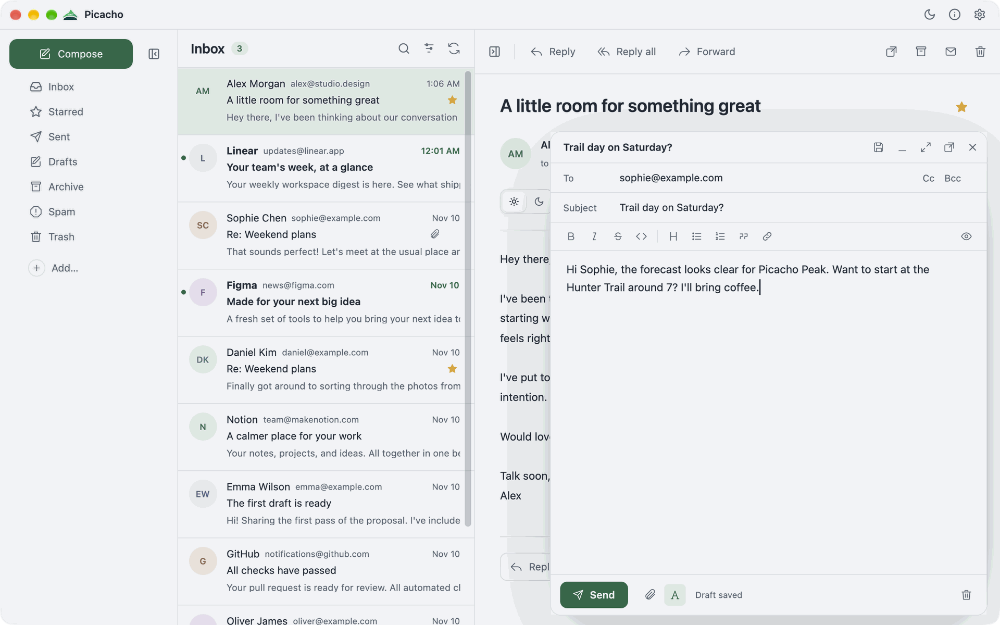

<p align="center">
  
</p>

<h1 align="center">Picacho</h1>

<p align="center"><strong>Fast, native email for every inbox you have.</strong></p>

<p align="center">
  <a href="https://github.com/pinaltech/Picacho/actions/workflows/ci.yml"></a>
  <a href="LICENSE"></a>
  <a href="Cargo.toml"></a>
</p>

<p align="center">Made by <a href="https://pinal.tech">Pinal Technologies</a> with ❤️</p>

<picture>
  <source media="(prefers-color-scheme: dark)" srcset="docs/screenshots/inbox-dark.png">
  
</picture>



<sub>Screenshots use Picacho's built-in sample inbox.</sub>

## Install

**Android:** add Picacho's repository to [F-Droid](https://f-droid.org),
Droid-ify or Neo Store, then install Picacho from it:

```
https://android.repo.pinal.tech/repo?fingerprint=a029e7fcd4c66d85aa0baea0f87db04c854c559f056a8b2032b4b26d186ee9d5
```

For the rolling beta, install Picacho Beta from the same repository; it sits
beside the release. Each
[GitHub release](https://github.com/pinaltech/Picacho/releases) also has the
APKs (`arm64-v8a` for most phones, `x86_64` for emulators and Chromebooks).

**Linux:** Picacho's Flatpak repository has x86_64 and aarch64 builds:

```sh
flatpak install --from https://linux.repo.pinal.tech/tech.pinal.picacho.stable.flatpakref
```

For betas, use `tech.pinal.picacho.beta.flatpakref`. To add the repository
alone: `flatpak remote-add picacho https://linux.repo.pinal.tech/picacho.flatpakrepo`.

Picacho is a fast, native email client written in Rust with GPUI. It runs without Electron or a webview, and it works with the mail you already have. Gray surfaces, a three-pane layout, rounded controls, and light and dark palettes with a choice of theme colors keep the focus on your mail.

## Build

Requirements: Rust 1.100 or later. On macOS 12 or later, Xcode with its command-line tools; if GPUI reports a missing Metal compiler, run `xcodebuild -downloadComponent MetalToolchain`. Credentials are kept in the system keychain on each platform: macOS Keychain, Windows Credential Manager, or the Secret Service on Linux.

Create an optimized, locally signed macOS application bundle:

```sh
sh scripts/bundle.sh
```

The script loads sign-in registrations such as `PICACHO_GOOGLE_CLIENT_ID` from a `.env` file in the project root, if there is one, and compiles them into the app. It uses the locked dependencies and creates `dist/Picacho.app`; on Linux it builds `dist/picacho` instead, with no bundle or signing. On first launch, the Linux build adds a `tech.pinal.picacho` desktop entry and its icon under `~/.local/share` so the dock, app grid and window switcher show the Picacho icon. It updates them whenever a different build runs, and skips them if a system package already installs that entry. The macOS bundle is an ad-hoc signed development build, not an Apple-notarized distribution. To regenerate the icon from `assets/brand/picacho.svg`:

```sh
swift scripts/icon.swift /tmp/Picacho.iconset
iconutil -c icns /tmp/Picacho.iconset -o assets/AppIcon.icns
```

### Windows

On Windows, with Rust's MSVC toolchain, Visual Studio's C++ build tools and a Windows SDK (GPUI's release builds compile their shaders with its `fxc.exe`), Perl for OpenSSL's build (Strawberry Perl, or Git for Windows'), and the .NET SDK 8 or later (the script installs the [WiX Toolset](https://wixtoolset.org) 5.0.2 pinned in `.config/dotnet-tools.json` with `dotnet tool restore`):

```powershell
powershell -ExecutionPolicy Bypass -File scripts\bundle-windows.ps1
```

This builds `dist\Picacho-<version>-x64.msi`, which installs for the current user without administrator rights (in `%LOCALAPPDATA%\Programs\Picacho`, with a Start menu shortcut). It reads `.env` like `bundle.sh`. The MSI and `picacho.exe` aren't signed unless `PICACHO_SIGNTOOL_CERT` (a `.pfx`) and `PICACHO_SIGNTOOL_PASSWORD` are set, so SmartScreen warns about them until they are. Proton's human verification needs the Microsoft Edge WebView2 runtime, which Windows 11 includes; Windows Hello needs Windows 10 1903 or later. Picacho starts without either and says so when it needs one, and on older Windows versions it offers security keys and phone passkeys itself.

From Linux, `sh scripts/bundle-windows.sh` cross-builds a debug `picacho.exe` (the `x86_64-pc-windows-gnu` target, with MinGW-w64 and lld) and, with `PICACHO_WIX` set to WiX run under Wine's .NET (see the script), an MSI for trying it under Wine. Debug builds compile GPUI's shaders when they start, from this computer's Cargo registry, so they run only where they were built. Release builds have to be made on Windows.

Ad-hoc signing and `cargo run` builds can change their Keychain identity whenever
the executable changes. macOS may ask for access again after recompilation,
even if an earlier build was allowed. To keep a stable identity, use the same
Apple Development or Developer ID Application certificate across builds:

```sh
PICACHO_CODESIGN_IDENTITY='Apple Development: Your Name (TEAMID)' sh scripts/bundle.sh
```

Picacho caches credentials and denied Keychain reads in memory for the session;
background checks do not repeatedly reopen a denied entry. Allow access in
Keychain Access and use **Try Again** in the mailbox's settings, or **Sign In
Again** to replace missing or expired credentials. Do not delete your mailbox
or grant all applications access to its Keychain entry. Production builds should
use a stable signing identity and bundle identifier; the rebuild-specific prompt
is primarily a development/ad-hoc signing concern. Native Keychain prompt behavior
still needs verification on macOS when changing signing or distribution.

### Android (experimental)

On Android, Picacho is a shared library (`src/android.rs`) that a
NativeActivity loads, and GPUI's Android platform comes from
[gpui-mobile](https://github.com/pinaltech/Picacho-Patches/tree/gpui-pre-android/gpui-mobile).
The Gradle project in `android/` packages it as an APK per ABI. It needs
the Android SDK (`ANDROID_HOME`) and NDK (`ANDROID_NDK_HOME`), JDK 17 or
later, `cargo-ndk` and the Rust targets:

```sh
rustup target add aarch64-linux-android x86_64-linux-android
cargo install cargo-ndk
sh scripts/build-android.sh
```

The APKs land in `android/app/build/outputs/apk/release`, signed with the
debug key unless `PICACHO_KEYSTORE` and its passwords are set (see the
script). `PICACHO_ABIS=arm64-v8a` builds one ABI. Credentials are kept in
the app's SharedPreferences, encrypted with an Android Keystore key. The
launcher icon's layers are `android/icon/*.svg`
(`sh scripts/android-icons.sh` renders them).

The Android app has what the desktop has, including:

- New-mail notifications, and checking for mail after Picacho is closed: a
  foreground service (`MailService`, with an ongoing notification) keeps
  checking, and starts again at boot. Settings → General turns it off.
- Attachments and account pictures from the system file picker
  (`GpuiPathPicker`).
- Home-screen widgets: a resizable **Inbox** widget (scrollable recent
  messages, unread count, account and unread-only filter, quick compose and
  refresh), a compact **Unread Mail** widget, an upcoming **Calendar**
  agenda widget, and **Packages** and **Receipts** widgets showing as many
  of your recent deliveries and receipts as fit, with **View all** for the
  rest.
- Proton: second factors with a security key (USB or NFC) or a passkey
  (Android 14 and later, through Credential Manager), and Proton's human
  verification (CAPTCHA) in a WebView (`VerifyActivity`).

### iOS (experimental)

On iOS, the same library (`src/ios.rs`) is linked statically into a small
host app, `packaging/ios`, whose scene gives gpui-mobile's view controller a
window and drives its frames. It needs Xcode signed in to an Apple account
(Settings > Accounts), [XcodeGen](https://github.com/yonaskolb/XcodeGen) and
the Rust target:

```sh
rustup target add aarch64-apple-ios
brew install xcodegen
sh scripts/bundle-ios.sh
```

This builds the app, signs it with your first Xcode team and installs and
opens it on the connected iPhone or iPad (Developer Mode on). `--debug`
builds faster; `--no-install` only builds. `PICACHO_IOS_TEAM`,
`PICACHO_IOS_BUNDLE_ID` and `PICACHO_IOS_DEVICE` choose another team,
bundle identifier or device. On first install, trust the developer in
Settings > General > VPN & Device Management. With a free Apple account the
app runs for 7 days before it must be installed again.

Credentials are kept in the app's own Keychain. As on Android, the iOS app
has:

- System notifications for new mail, with **Mark as Read**, **Archive**,
  **Delete** and **Reply** (`Notifications.swift`).
- Checking for mail in the background (Settings → General, on by default):
  iOS doesn't let apps stay connected once they leave the screen, so
  Picacho asks for background app refresh, and each time iOS wakes it,
  checks each inbox once, sends scheduled mail and brings back snoozed
  mail (`BackgroundRefresh.swift`). iOS decides how often, by how you use
  Picacho; it needs Background App Refresh on for Picacho in Settings.
- Proton: second factors with a security key held to the top of the iPhone
  (NFC, through Core NFC; iPads have no NFC), or a passkey on another phone
  or tablet by QR code and Bluetooth. Apple's own passkey APIs only sign
  for sites that list the app in their associated domains, which proton.me
  doesn't for Picacho. Proton's human verification (CAPTCHA) opens in a
  WKWebView sheet (`Verify.swift`).
- A Share extension (`ShareExtension/`): text, links, pictures and files
  shared from other apps start a new message.
- App icons at every iPhone and iPad size
  (`swift scripts/icon.swift packaging/ios/Assets.xcassets/AppIcon.appiconset ios`
  draws them).

Reading security keys needs the NFC Tag Reading capability
(`com.apple.developer.nfc.readersession.formats` in `project.yml`), and the
widgets and Share extension an App Group. If your team can't sign for one,
remove it from `project.yml`; only that feature goes.

### Built-in sign-in

Browser sign-in uses Picacho's own registration with each provider. Set these when building (in development builds, the same variables at run time override them; release builds ignore them at run time):

| Variable                                                   | Used for                                                                                                                                          |
| ---------------------------------------------------------- | ------------------------------------------------------------------------------------------------------------------------------------------------- |
| `PICACHO_GOOGLE_CLIENT_ID`, `PICACHO_GOOGLE_CLIENT_SECRET` | Google OAuth **Desktop app** client with the `https://mail.google.com/` scope; for **Use the Gmail API**, also the Gmail API turned on in its project and `https://www.googleapis.com/auth/gmail.settings.basic` |
| `PICACHO_MICROSOFT_CLIENT_ID`                              | Microsoft Entra public client with `http://localhost` as a mobile and desktop redirect URI, and delegated `IMAP.AccessAsUser.All` and `SMTP.Send`; for **Use Microsoft Graph**, also Microsoft Graph's delegated `Mail.ReadWrite`, `Mail.Send`, `MailboxSettings.ReadWrite`, `Calendars.ReadWrite`, `Contacts.ReadWrite` and `People.Read` (none needs an administrator's consent). Exchange Server with hybrid modern authentication uses it too unless the administrator gives a client id: the organization's administrator consents to Office 365 Exchange Online's `EWS.AccessAsUser.All` for its on-premises server's URL |
| `PICACHO_FASTMAIL_CLIENT_ID`                               | Fastmail OAuth public client with a loopback redirect (`http://127.0.0.1:<port>/callback`) and the JMAP core, mail, submission and Sieve scopes |

Pinal Mail signs in with Pinal Accounts, and the mail server accepts Pinal's tokens over IMAP, SMTP and ManageSieve (XOAUTH2/OAUTHBEARER), so no password is stored. Picacho is an ordinary **native** app in Pinal's Developers portal, with redirect URIs `http://127.0.0.1/callback` (any port) and `https://accounts.pinal.tech/native/callback` (used by the macOS bundle, which Pinal hands back to `picacho://`), and the scopes `openid profile email offline_access mail.read mail.labels mail.compose mail.send mail.settings`.

| Variable                       | Used for                                                                                   |
| ------------------------------ | ------------------------------------------------------------------------------------------ |
| `PICACHO_PINAL_CLIENT_ID`      | That app's client ID                                                                       |
| `PICACHO_PINAL_ACCOUNTS`       | Pinal Accounts' origin (default `https://accounts.pinal.tech`)                             |
| `PICACHO_PINAL_MAIL_DOMAINS`   | Comma-separated Pinal Mail domains (default `sonoran.exchange`)                            |
| `PICACHO_PINAL_IMAP`, `PICACHO_PINAL_SMTP` | `host:port` of the mail servers (default `mail.sonoran.exchange:993` and `:465`) |

`src/manage/pinal_tests.rs` has an ignored live test that signs in to a local Pinal Accounts and checks IMAP, SMTP and token refresh against a local Picacho Server; its header shows how to run it.

Without a Fastmail client, Fastmail asks for an API token. Other JMAP servers sign in in the browser where their OAuth metadata allows apps to register themselves (RFC 7591), with no registration built in. Without a Google client, Gmail falls back to an app password. Without a Microsoft client, Outlook asks for a password, which most Microsoft accounts no longer accept for IMAP.

Proton Mail without Bridge (Direct) identifies the app to Proton's API as `<platform>-<token>@<version>` (`x-pm-appversion`), from `PICACHO_PROTON_APP_TOKEN` and `PICACHO_PROTON_APP_VERSION`. Direct is offered only when at least one of them is set; the other then defaults to `picacho` or Picacho's own version. `<platform>` is the system Picacho was built for (`linux`, `macos` or `windows`); `PICACHO_PROTON_APP_PLATFORM_OVERRIDE` names another, such as `linux` on a Windows build. It doesn't make Direct available by itself. Without either of the first two, Proton Mail connects through Proton Mail Bridge alone. Unlike the variables above, these are only read at build time.

A Proton Direct account can also receive Proton's push notifications as Proton's Android app does (its **Push notifications** setting). Picacho keeps one connection open to Firebase Cloud Messaging, and Proton sends each notification down it, encrypted to a device key only this installation holds; nothing is polled. One registration serves every such account: its token, the device key and the pushes already shown are kept in the system keychain, so restarting Picacho (or Android's mail service) reuses them. The Firebase project comes from `PICACHO_PROTON_FCM_API_KEY`, `PICACHO_PROTON_FCM_APP_ID` and `PICACHO_PROTON_FCM_PROJECT_ID` (all three needed for the setting to be offered), and for projects restricted to an Android app, `PICACHO_PROTON_FCM_PACKAGE` and `PICACHO_PROTON_FCM_CERT_SHA1` (the signing certificate's SHA-1, with or without colons); `PICACHO_PROTON_FCM_SENDER_ID` defaults to the project number in the app id, and `PICACHO_PROTON_FCM_VAPID_KEY` is optional. These are read at build time, and in development builds the same variables at run time override them. Registering the device with Proton (`POST /core/v4/devices`) can identify the app differently from every other request: `PICACHO_PROTON_PUSH_APP_TOKEN`, `PICACHO_PROTON_PUSH_APP_VERSION` and `PICACHO_PROTON_PUSH_APP_PLATFORM` (read at build time) replace the token, version and platform for that request alone, each one unset being the general one. Proton registers devices only for sessions that identify as its Android app (`PICACHO_PROTON_APP_PLATFORM_OVERRIDE=android`, `PICACHO_PROTON_APP_TOKEN=mail`). Failures (a registration Proton refused, a push that couldn't be opened) are logged to standard error, or Android's log; what a push says never is.

Proton's own aliases (Settings → Forwarding → Proton) are kept in Proton Pass, and Proton gives a session Pass access (the `pass` scope) only when it signed in as an app with Pass: neither the mail registration above nor a fork of its session has it. `PICACHO_PROTON_PASS_APP_TOKEN`, `PICACHO_PROTON_PASS_APP_VERSION` and `PICACHO_PROTON_PASS_APP_PLATFORM` (read at build time) name such a registration: with a token or version set, adding the service signs in to Pass separately, in the same steps as signing in to Proton Mail (the password, then the account's second factor: an authenticator code, a security key or a passkey; no mailbox password, as the Pass session's keys aren't unlocked). Only that session is kept, in the system keychain with its renewed tokens; its keys stay locked, as vaults open with the mail session's keys. Removing the service signs it out. Each one unset is the general one; with neither token nor version, Pass's requests use the account's own session.

## Features

Beyond reading, writing and organizing mail, Picacho has:

- **Mail that keeps going while it's closed.** Once the last window closes,
  Picacho can keep running in the background (Settings → General, on by
  default) as a small process with a tray icon. It checks for new mail,
  sends Send Later messages at their time and brings snoozed mail back.
  Where the server can hold a message (SMTP FUTURERELEASE, JMAP HOLDUNTIL),
  Settings → account → Sending → **Let the server send scheduled messages**
  sends it even when the computer is off.
- **Inline images.** Pictures the HTML shows from the message itself
  (`cid:` parts, such as logos and signatures) are displayed, even with
  remote content blocked.
- **Calendar invitations** (Settings → Calendar). An invitation in mail
  (iCalendar, from Google, Outlook, Apple and others) shows what, when, where
  and who above the message, with **Accept**, **Maybe** and **Decline**.
  The answer goes to the organizer as a standard iMIP reply, from the
  address that was invited. Cancellations and published events show too.
- **Calendars over CalDAV** (Settings → Calendar). Connect Fastmail, iCloud,
  Nextcloud, Radicale or another CalDAV server. Accepted invitations go in
  your calendar, and declined ones come out. Settings → Calendar lists
  what's coming up, each repeat of a repeating event included, and adds,
  edits and deletes events, one repeat or all of them. With Local AI's
  Understand dates, you can write times as "tomorrow at 10" or "every
  monday at 9", in the event's own time zone (Picacho says what time that
  is for you). Guests you add get an invitation from your account, and a
  cancellation if the event is deleted. Their answers, and times they
  propose instead, show on their mail: move the event or keep the time.
  As a guest, you can propose another time too, and an invitation that
  changed after you answered offers to update your calendar. Repeating
  rules from other apps, such as "the last weekday of the month", show
  every time they happen. Changes go to the server, and are refused when
  the event was changed elsewhere meanwhile.
- **Encrypted mail with OpenPGP or S/MIME** (Settings → Encryption).
  - *OpenPGP:* import your key and others' keys (`.asc`). Picacho also finds
    people's keys by itself: on their domain (WKD), on keys.openpgp.org, and
    in the Autocrypt headers their mail apps send. A key you imported never
    gets replaced, and an Autocrypt header (which anyone can forge) never
    replaces a key found on the domain or a keyserver. Your signed mail
    carries your key the same way.
  - Your own keys are kept in the system keychain; other people's keys
    are kept in Picacho's database.
  - *S/MIME:* import your certificate (`.p12`/`.pfx`). Others'
    certificates are kept from the signed mail they send you, or imported
    (`.pem`, `.crt`, `.cer`). Signatures are checked against your system's
    trusted authorities.
  - Mail encrypted to you opens when read and stays encrypted on disk. The
    message details say who signed it, or that it was changed, and name
    any attachments of an inline PGP message that its signature or
    encryption doesn't cover.
  - The composer's **Sign** and **Encrypt** buttons sign with your key and
    encrypt to each recipient and yourself. Picacho looks up missing keys
    before sending, and says when one it found hasn't been checked. To
    check one, **Check…** shows its fingerprint and QR code; paste the
    fingerprint its owner gave you and Picacho compares them. **Encrypt the
    subject too** hides the subject and the thread it's part of outside
    the encryption (others see "..."). Encrypted drafts, OpenPGP or
    S/MIME, sync with the server's Drafts sealed to your own key or
    certificate, so other devices with it can open them.
  - Pinal Mail's zero-access encryption works without any of this.
- **App lock and an encrypted database** (Settings → Privacy).
  - *App lock:* Picacho asks for a passcode, or Touch ID, Face ID or the
    phone's fingerprint or face unlock, when it opens and when you come back
    to it after a while (immediately, or after 1, 5, 15 or 60 minutes away).
    **Lock Picacho** in the Picacho menu (⌥⌘L, Ctrl+Alt+L) locks it at
    once. Its other windows are covered meanwhile, and on phones so is the
    app switcher's picture. Mail is still checked, and new mail announced,
    while it's locked; **Hide mail outside Picacho** (on with the lock)
    keeps who and what out of notifications and widgets. Tries slow down
    after five wrong passcodes.
  - *Encrypted database:* the local copy of your mail, drafts, contacts,
    calendars and settings is encrypted with SQLCipher (AES-256), with a
    random key kept in the system keychain, so background checks still
    run without asking. Turning it on or off rewrites the database in
    place. If the keychain loses the key, the local copy can't be read:
    Picacho says so at launch and can move it aside to start over (mail
    kept only on this device stays in the old file).
- **Contacts** (Settings → Contacts). Picacho reads your address books from
  a CardDAV server (Fastmail, iCloud, Nextcloud, Radicale and others; RFC
  6352), and adds, edits and deletes contacts there. It keeps what other
  apps store on a card, such as photos and birthdays, as it was. Without a
  server, contacts stay on this computer. vCard files (`.vcf`) can be
  imported and exported. The composer suggests these people first, then
  people from your mail.
- **Export and import.** A mailbox's menu (right-click it in the sidebar)
  has **Export as Mbox…**, which saves its messages as one mboxrd file for
  Thunderbird, Apple Mail, mutt or a backup. **Import Messages…** adds
  `.mbox` files and single `.eml` messages to it on the server (IMAP
  APPEND, JMAP Email/import, Proton's import), or on this computer for POP3.
- **Screen readers, the keyboard, and reduced motion.** Buttons, links,
  switches, segmented choices, menus, settings pages, folders, messages,
  contacts and events tell assistive technology what they are, what they're
  called, and whether they're on or selected. This works with VoiceOver,
  Narrator and Orca, through AccessKit. Each message row reads as "Unread,
  sender, subject, date, preview". Tab and Shift-Tab move between controls
  with a visible focus ring, and Return or Space presses them. A menu takes
  the keyboard when it opens. Settings → General → **Reduce motion**
  follows the system's setting (desktops and phones, checked again
  whenever the window comes to the front), or your own: panes, menus and messages then
  appear without moving, and spinners stand still.

## Connect email

The setup lists the supported services. Each one signs in the simplest way it allows, and no one is asked for server settings unless they choose another provider and its settings can't be found.

| Service          | Sign-in                                   | Servers                                                          |
| ---------------- | ----------------------------------------- | ---------------------------------------------------------------- |
| Pinal Mail       | Pinal Accounts in the browser             | `mail.sonoran.exchange:993`, `:465`                              |
| Gmail            | Google in the browser, or an app password | `imap.gmail.com:993`, `smtp.gmail.com:587`; or the Gmail API (`gmail.googleapis.com`) |
| Outlook          | Microsoft in the browser                  | `outlook.office365.com:993`, `smtp.office365.com:587`; or Microsoft Graph (`graph.microsoft.com`) |
| iCloud Mail      | App-specific password                     | `imap.mail.me.com:993`, `smtp.mail.me.com:587`                   |
| Fastmail         | Fastmail in the browser, or an API token  | JMAP at `api.fastmail.com:443`                                   |
| Zoho Mail        | App password (IMAP turned on in Zoho)     | `imap.zoho.<region>:993`, `smtp.zoho.<region>:465`               |
| Proton Mail (Direct tab) | Proton password, then a two-factor code, security key or passkey and the mailbox password where the account has them | Proton's API (`mail-api.proton.me`); no Bridge |
| Exchange Server  | Password (NTLMv2, or Basic where that's all the server takes), Kerberos, or Microsoft Entra (hybrid modern authentication) | Exchange Web Services, found by Autodiscover (or entered): `https://<server>/EWS/Exchange.asmx` |
| Proton Mail (Bridge tab) | Proton Mail Bridge password         | Bridge on this computer, `127.0.0.1:1143` (STARTTLS) and `:1025` |
| Another provider | Password, or the browser for JMAP servers that allow it | Found by JMAP SRV records, autoconfiguration, or entered by hand |

## Documentation

- [Using Picacho](docs/USAGE.md): running, settings, sync behavior, storage and current limits
- [Architecture](docs/ARCHITECTURE.md): module boundaries and extension points
- [Synchronization](docs/SYNCHRONIZATION.md) and [display](docs/DISPLAY.md): behavior contracts and checks
- [Verification](docs/VERIFICATION.md): checks that have been run

## Releasing

Work happens on three branches:

- **dev**: where changes land. Pushes and pull requests run the tests only.
- **beta**: the rolling beta. Every push builds and publishes "Picacho Beta"
  for Android (`tech.pinal.picacho.beta`, installed beside the release), the
  Flatpak `beta` branch, and the GitHub pre-release `beta-build`, replacing the last
  one. Beta builds have no version number; they call themselves "Beta Build".
- **stable**: releases. It takes changes only through pull requests, which
  can merge once the tests pass and the version is new. Merging publishes
  Cargo.toml's version and tags it `vX.Y.Z`.

To release, on a branch for the pull request into stable:

1. Set a new version in `Cargo.toml` and move CHANGELOG.md's **Unreleased**
   notes under `## [X.Y.Z] - YYYY-MM-DD`.
2. Open the pull request into `stable`. Its "Stable version" check fails
   while `vX.Y.Z` already exists.

`.github/workflows/release.yml` builds and publishes both channels. It
publishes to Cloudflare R2 (buckets `android-repository` and `linux-repository`,
served at android.repo.pinal.tech and linux.repo.pinal.tech) and needs these
repository secrets: `R2_ACCOUNT_ID`, `R2_ACCESS_KEY_ID`,
`R2_SECRET_ACCESS_KEY`, `PICACHO_KEYSTORE_BASE64`,
`PICACHO_KEYSTORE_PASSWORD`, `FDROID_KEYSTORE_BASE64`,
`FDROID_KEYSTORE_PASSWORD` and `FLATPAK_GPG_PRIVATE_KEY`.
