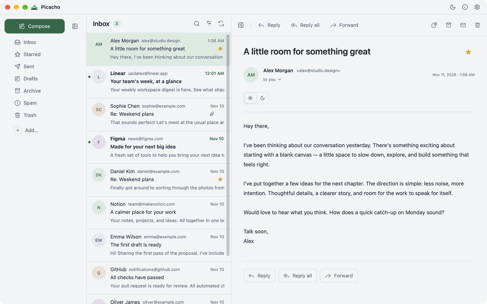
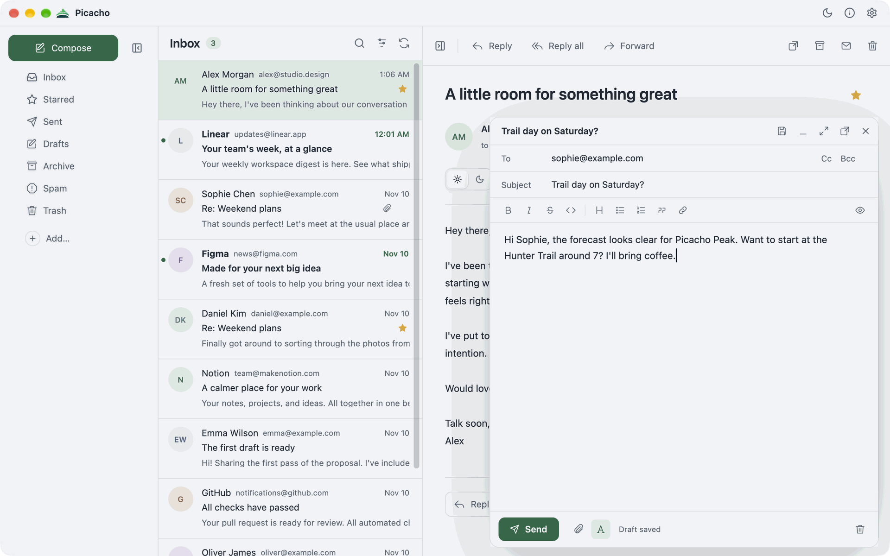

<p align="center">
  
</p>

<h1 align="center">Picacho</h1>

<p align="center"><strong>Fast, native email for every inbox you have.</strong></p>

<p align="center">
  <a href="https://github.com/pinaltech/Picacho/actions/workflows/ci.yml"></a>
  <a href="LICENSE"></a>
  <a href="Cargo.toml"></a>
</p>

<p align="center">Made by <a href="https://pinal.tech">Pinal Technologies</a> with ❤️</p>

<picture>
  <source media="(prefers-color-scheme: dark)" srcset="docs/screenshots/inbox-dark.png">
  
</picture>



<sub>Screenshots use Picacho's built-in sample inbox.</sub>

Picacho is a fast, native email client written in Rust with GPUI. It runs without Electron or a webview, and it works with the mail you already have. Gray surfaces, a three-pane layout, rounded controls, and light and dark palettes with a choice of theme colors keep the focus on your mail.

## Build

Requirements: Rust 1.98 or later. On macOS 12 or later, Xcode with its command-line tools; if GPUI reports a missing Metal compiler, run `xcodebuild -downloadComponent MetalToolchain`. Credentials are kept in the system keychain on each platform: macOS Keychain, Windows Credential Manager, or the Secret Service on Linux.

Create an optimized, locally signed macOS application bundle:

```sh
sh scripts/bundle.sh
```

The script loads sign-in registrations such as `PICACHO_GOOGLE_CLIENT_ID` from a `.env` file in the project root, if there is one, and compiles them into the app. It uses the locked dependencies and creates `dist/Picacho.app`; on Linux it builds `dist/picacho` instead, with no bundle or signing. On first launch, the Linux build adds a `tech.pinal.picacho` desktop entry and its icon under `~/.local/share` so the dock, app grid and window switcher show the Picacho icon. It updates them whenever a different build runs, and skips them if a system package already installs that entry. The macOS bundle is an ad-hoc signed development build, not an Apple-notarized distribution. To regenerate the icon from `assets/brand/picacho.svg`:

```sh
swift scripts/icon.swift /tmp/Picacho.iconset
iconutil -c icns /tmp/Picacho.iconset -o assets/AppIcon.icns
```

Ad-hoc signing and `cargo run` builds can change their Keychain identity whenever
the executable changes. macOS may ask for access again after recompilation,
even if an earlier build was allowed. To keep a stable identity, use the same
Apple Development or Developer ID Application certificate across builds:

```sh
PICACHO_CODESIGN_IDENTITY='Apple Development: Your Name (TEAMID)' sh scripts/bundle.sh
```

Picacho caches credentials and denied Keychain reads in memory for the session;
background checks do not repeatedly reopen a denied entry. Allow access in
Keychain Access and use **Try Again** in the mailbox's settings, or **Sign In
Again** to replace missing or expired credentials. Do not delete your mailbox
or grant all applications access to its Keychain entry. Production builds should
use a stable signing identity and bundle identifier; the rebuild-specific prompt
is primarily a development/ad-hoc signing concern. Native Keychain prompt behavior
still needs verification on macOS when changing signing or distribution.

### Built-in sign-in

Browser sign-in uses Picacho's own registration with each provider. Set these when building (the same variables at run time override them, for development):

| Variable                                                   | Used for                                                                                                                                          |
| ---------------------------------------------------------- | ------------------------------------------------------------------------------------------------------------------------------------------------- |
| `PICACHO_GOOGLE_CLIENT_ID`, `PICACHO_GOOGLE_CLIENT_SECRET` | Google OAuth **Desktop app** client with the `https://mail.google.com/` scope                                                                     |
| `PICACHO_MICROSOFT_CLIENT_ID`                              | Microsoft Entra public client with `http://localhost` as a mobile and desktop redirect URI, and delegated `IMAP.AccessAsUser.All` and `SMTP.Send` |

Without a Google client, Gmail falls back to an app password. Without a Microsoft client, Outlook asks for a password, which most Microsoft accounts no longer accept for IMAP.

## Connect email

The setup lists the supported services. Each one signs in the simplest way it allows, and no one is asked for server settings unless they choose another provider and its settings can't be found.

| Service          | Sign-in                                   | Servers                                                          |
| ---------------- | ----------------------------------------- | ---------------------------------------------------------------- |
| Gmail            | Google in the browser, or an app password | `imap.gmail.com:993`, `smtp.gmail.com:587`                       |
| Outlook          | Microsoft in the browser                  | `outlook.office365.com:993`, `smtp.office365.com:587`            |
| iCloud Mail      | App-specific password                     | `imap.mail.me.com:993`, `smtp.mail.me.com:587`                   |
| Fastmail         | App password                              | `imap.fastmail.com:993`, `smtp.fastmail.com:465`                 |
| Zoho Mail        | App password (IMAP turned on in Zoho)     | `imap.zoho.<region>:993`, `smtp.zoho.<region>:465`               |
| Proton Mail      | Proton Mail Bridge password               | Bridge on this computer, `127.0.0.1:1143` (STARTTLS) and `:1025` |
| Another provider | Password                                  | Found by autoconfiguration, or entered by hand                   |

## Documentation

- [Using Picacho](docs/USAGE.md): running, settings, sync behavior, storage and current limits
- [Architecture](docs/ARCHITECTURE.md): module boundaries and extension points
- [Synchronization](docs/SYNCHRONIZATION.md) and [display](docs/DISPLAY.md): behavior contracts and checks
- [Verification](docs/VERIFICATION.md): checks that have been run
