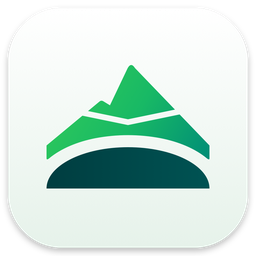
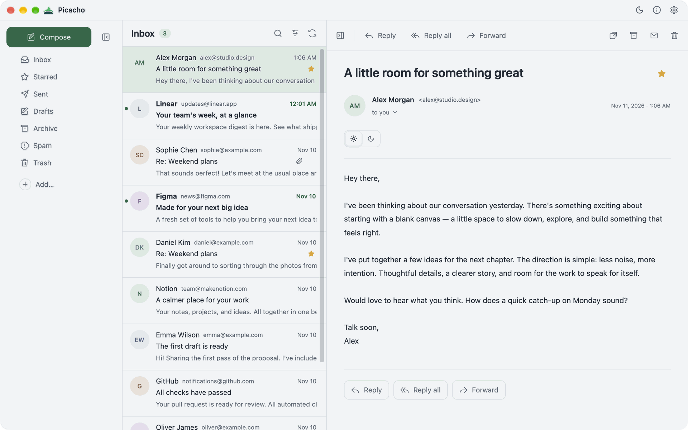

<p align="center">
  
</p>

<h1 align="center">Picacho</h1>

<p align="center"><strong>Fast, native email for every inbox you have.</strong></p>

<p align="center">
  <a href="https://github.com/pinaltech/Picacho/actions/workflows/ci.yml"></a>
  <a href="LICENSE"></a>
  <a href="Cargo.toml"></a>
</p>

<p align="center">Made by <a href="https://pinal.tech">Pinal Technologies</a> with ❤️</p>

<picture>
  <source media="(prefers-color-scheme: dark)" srcset="docs/screenshots/inbox-dark.png">
  
</picture>


<sub>Screenshots use Picacho's built-in sample inbox.</sub>

## Install

**Android:** add Picacho's repository to [F-Droid](https://f-droid.org),
Droid-ify or Neo Store, then install Picacho from it:

```
https://android.repo.pinal.tech/repo?fingerprint=a029e7fcd4c66d85aa0baea0f87db04c854c559f056a8b2032b4b26d186ee9d5
```

For the rolling beta, install Picacho Beta from the same repository; it sits
beside the release. Each
[GitHub release](https://github.com/pinaltech/Picacho/releases) also has the
APKs (`arm64-v8a` for most phones, `x86_64` for emulators and Chromebooks).

**Linux:** Picacho's Flatpak repository has x86_64 and aarch64 builds:

```sh
flatpak install --from https://linux.repo.pinal.tech/tech.pinal.picacho.stable.flatpakref
```

For betas, use `tech.pinal.picacho.beta.flatpakref`. To add the repository
alone: `flatpak remote-add picacho https://linux.repo.pinal.tech/picacho.flatpakrepo`.

Picacho is a fast, native email client written in Rust with GPUI. It runs without Electron or a webview, and it works with the mail you already have. Gray surfaces, a three-pane layout, rounded controls, and light and dark palettes with a choice of theme colors keep the focus on your mail.

## Build

Requirements: Rust 1.100 or later. On macOS 12 or later, Xcode with its command-line tools; if GPUI reports a missing Metal compiler, run `xcodebuild -downloadComponent MetalToolchain`. Credentials are kept in the system keychain on each platform: macOS Keychain, Windows Credential Manager, or the Secret Service on Linux.

Create an optimized, locally signed macOS application bundle:

```sh
sh scripts/bundle.sh
```

The script loads sign-in registrations such as `PICACHO_GOOGLE_CLIENT_ID` from a `.env` file in the project root, if there is one, and compiles them into the app. It uses the locked dependencies and creates `dist/Picacho.app`; on Linux it builds `dist/picacho` instead, with no bundle or signing. On first launch, the Linux build adds a `tech.pinal.picacho` desktop entry and its icon under `~/.local/share` so the dock, app grid and window switcher show the Picacho icon. It updates them whenever a different build runs, and skips them if a system package already installs that entry. The macOS bundle is an ad-hoc signed development build, not an Apple-notarized distribution. To regenerate the icon from `assets/brand/picacho.svg`:

```sh
swift scripts/icon.swift /tmp/Picacho.iconset
iconutil -c icns /tmp/Picacho.iconset -o assets/AppIcon.icns
```

Ad-hoc signing and `cargo run` builds can change their Keychain identity whenever
the executable changes. macOS may ask for access again after recompilation,
even if an earlier build was allowed. To keep a stable identity, use the same
Apple Development or Developer ID Application certificate across builds:

```sh
PICACHO_CODESIGN_IDENTITY='Apple Development: Your Name (TEAMID)' sh scripts/bundle.sh
```

Picacho caches credentials and denied Keychain reads in memory for the session;
background checks do not repeatedly reopen a denied entry. Allow access in
Keychain Access and use **Try Again** in the mailbox's settings, or **Sign In
Again** to replace missing or expired credentials. Do not delete your mailbox
or grant all applications access to its Keychain entry. Production builds should
use a stable signing identity and bundle identifier; the rebuild-specific prompt
is primarily a development/ad-hoc signing concern. Native Keychain prompt behavior
still needs verification on macOS when changing signing or distribution.

### Android (experimental)

On Android, Picacho is a shared library (`src/android.rs`) that a
NativeActivity loads, and GPUI's Android platform comes from
[gpui-mobile](https://github.com/pinaltech/Picacho-Patches/tree/gpui-pre-android/gpui-mobile).
The Gradle project in `android/` packages it as an APK per ABI. It needs
the Android SDK (`ANDROID_HOME`) and NDK (`ANDROID_NDK_HOME`), JDK 17 or
later, `cargo-ndk` and the Rust targets:

```sh
rustup target add aarch64-linux-android x86_64-linux-android
cargo install cargo-ndk
sh scripts/build-android.sh
```

The APKs land in `android/app/build/outputs/apk/release`, signed with the
debug key unless `PICACHO_KEYSTORE` and its passwords are set (see the
script). `PICACHO_ABIS=arm64-v8a` builds one ABI. Credentials are kept in
the app's SharedPreferences, encrypted with an Android Keystore key. The
launcher icon's layers are `android/icon/*.svg`
(`sh scripts/android-icons.sh` renders them). Not yet on Android:

- System notifications.
- Attachments from the file picker (gpui-mobile's Java helper classes are
  not in the APK).
- Proton: security keys and phone passkeys (sign-in uses the authenticator
  app's code instead), and human verification (CAPTCHA).

### iOS (experimental)

On iOS, the same library (`src/ios.rs`) is linked statically into a small
host app, `packaging/ios`, whose scene gives gpui-mobile's view controller a
window and drives its frames. It needs Xcode signed in to an Apple account
(Settings > Accounts), [XcodeGen](https://github.com/yonaskolb/XcodeGen) and
the Rust target:

```sh
rustup target add aarch64-apple-ios
brew install xcodegen
sh scripts/bundle-ios.sh
```

This builds the app, signs it with your first Xcode team and installs and
opens it on the connected iPhone or iPad (Developer Mode on). `--debug`
builds faster; `--no-install` only builds. `PICACHO_IOS_TEAM`,
`PICACHO_IOS_BUNDLE_ID` and `PICACHO_IOS_DEVICE` choose another team,
bundle identifier or device. On first install, trust the developer in
Settings > General > VPN & Device Management. With a free Apple account the
app runs for 7 days before it must be installed again.

Credentials are kept in the app's own Keychain. Not yet on iOS: system
notifications, Proton's security keys, phone passkeys and human
verification (as on Android), and app icons other than the 1024-pixel one
(`swift scripts/icon.swift packaging/ios/Assets.xcassets/AppIcon.appiconset ios`).

### Built-in sign-in

Browser sign-in uses Picacho's own registration with each provider. Set these when building (the same variables at run time override them, for development):

| Variable                                                   | Used for                                                                                                                                          |
| ---------------------------------------------------------- | ------------------------------------------------------------------------------------------------------------------------------------------------- |
| `PICACHO_GOOGLE_CLIENT_ID`, `PICACHO_GOOGLE_CLIENT_SECRET` | Google OAuth **Desktop app** client with the `https://mail.google.com/` scope                                                                     |
| `PICACHO_MICROSOFT_CLIENT_ID`                              | Microsoft Entra public client with `http://localhost` as a mobile and desktop redirect URI, and delegated `IMAP.AccessAsUser.All` and `SMTP.Send` |
| `PICACHO_FASTMAIL_CLIENT_ID`                               | Fastmail OAuth public client with a loopback redirect (`http://127.0.0.1:<port>/callback`) and the JMAP core, mail, submission and Sieve scopes |

Pinal Mail signs in with Pinal Accounts, and the mail server accepts Pinal's tokens over IMAP, SMTP and ManageSieve (XOAUTH2/OAUTHBEARER), so no password is stored. Picacho is an ordinary **native** app in Pinal's Developers portal, with redirect URIs `http://127.0.0.1/callback` (any port) and `https://accounts.pinal.tech/native/callback` (used by the macOS bundle, which Pinal hands back to `picacho://`), and the scopes `openid profile email offline_access mail.read mail.labels mail.compose mail.send mail.settings`.

| Variable                       | Used for                                                                                   |
| ------------------------------ | ------------------------------------------------------------------------------------------ |
| `PICACHO_PINAL_CLIENT_ID`      | That app's client ID                                                                       |
| `PICACHO_PINAL_ACCOUNTS`       | Pinal Accounts' origin (default `https://accounts.pinal.tech`)                             |
| `PICACHO_PINAL_MAIL_DOMAINS`   | Comma-separated Pinal Mail domains (default `sonoran.exchange`)                            |
| `PICACHO_PINAL_IMAP`, `PICACHO_PINAL_SMTP` | `host:port` of the mail servers (default `mail.sonoran.exchange:993` and `:465`) |

`src/manage/pinal_tests.rs` has an ignored live test that signs in to a local Pinal Accounts and checks IMAP, SMTP and token refresh against a local Picacho Server; its header shows how to run it.

Without a Fastmail client, Fastmail asks for an API token. Other JMAP servers sign in in the browser where their OAuth metadata allows apps to register themselves (RFC 7591), with no registration built in. Without a Google client, Gmail falls back to an app password. Without a Microsoft client, Outlook asks for a password, which most Microsoft accounts no longer accept for IMAP.

Proton Mail without Bridge (Direct) identifies the app to Proton's API as `<platform>-<token>@<version>` (`x-pm-appversion`), from `PICACHO_PROTON_APP_TOKEN` and `PICACHO_PROTON_APP_VERSION`. Direct is offered only when at least one of them is set; the other then defaults to `picacho` or Picacho's own version. `<platform>` is the system Picacho was built for (`linux`, `macos` or `windows`); `PICACHO_PROTON_APP_PLATFORM_OVERRIDE` names another, such as `linux` on a Windows build. It doesn't make Direct available by itself. Without either of the first two, Proton Mail connects through Proton Mail Bridge alone. Unlike the variables above, these are only read at build time.

A Proton Direct account can also receive Proton's push notifications as Proton's Android app does (its **Push notifications** setting). Picacho keeps one connection open to Firebase Cloud Messaging, and Proton sends each notification down it, encrypted to a device key only this installation holds; nothing is polled. One registration serves every such account: its token, the device key and the pushes already shown are kept in the system keychain, so restarting Picacho (or Android's mail service) reuses them. The Firebase project comes from `PICACHO_PROTON_FCM_API_KEY`, `PICACHO_PROTON_FCM_APP_ID` and `PICACHO_PROTON_FCM_PROJECT_ID` (all three needed for the setting to be offered), and for projects restricted to an Android app, `PICACHO_PROTON_FCM_PACKAGE` and `PICACHO_PROTON_FCM_CERT_SHA1` (the signing certificate's SHA-1, with or without colons); `PICACHO_PROTON_FCM_SENDER_ID` defaults to the project number in the app id, and `PICACHO_PROTON_FCM_VAPID_KEY` is optional. These are read at build time, and the same variables at run time override them. Registering the device with Proton (`POST /core/v4/devices`) can identify the app differently from every other request: `PICACHO_PROTON_PUSH_APP_TOKEN`, `PICACHO_PROTON_PUSH_APP_VERSION` and `PICACHO_PROTON_PUSH_APP_PLATFORM` (read at build time) replace the token, version and platform for that request alone, each one unset being the general one. Proton registers devices only for sessions that identify as its Android app (`PICACHO_PROTON_APP_PLATFORM_OVERRIDE=android`, `PICACHO_PROTON_APP_TOKEN=mail`). Failures (a registration Proton refused, a push that couldn't be opened) are logged to standard error, or Android's log; what a push says never is.

## Connect email

The setup lists the supported services. Each one signs in the simplest way it allows, and no one is asked for server settings unless they choose another provider and its settings can't be found.

| Service          | Sign-in                                   | Servers                                                          |
| ---------------- | ----------------------------------------- | ---------------------------------------------------------------- |
| Pinal Mail       | Pinal Accounts in the browser             | `mail.sonoran.exchange:993`, `:465`                              |
| Gmail            | Google in the browser, or an app password | `imap.gmail.com:993`, `smtp.gmail.com:587`                       |
| Outlook          | Microsoft in the browser                  | `outlook.office365.com:993`, `smtp.office365.com:587`            |
| iCloud Mail      | App-specific password                     | `imap.mail.me.com:993`, `smtp.mail.me.com:587`                   |
| Fastmail         | Fastmail in the browser, or an API token  | JMAP at `api.fastmail.com:443`                                   |
| Zoho Mail        | App password (IMAP turned on in Zoho)     | `imap.zoho.<region>:993`, `smtp.zoho.<region>:465`               |
| Proton Mail (Direct tab) | Proton password, then a two-factor code, security key or passkey and the mailbox password where the account has them | Proton's API (`mail-api.proton.me`); no Bridge |
| Proton Mail (Bridge tab) | Proton Mail Bridge password         | Bridge on this computer, `127.0.0.1:1143` (STARTTLS) and `:1025` |
| Another provider | Password, or the browser for JMAP servers that allow it | Found by JMAP SRV records, autoconfiguration, or entered by hand |

## Documentation

- [Using Picacho](docs/USAGE.md): running, settings, sync behavior, storage and current limits
- [Architecture](docs/ARCHITECTURE.md): module boundaries and extension points
- [Synchronization](docs/SYNCHRONIZATION.md) and [display](docs/DISPLAY.md): behavior contracts and checks
- [Verification](docs/VERIFICATION.md): checks that have been run

## Releasing

Work happens on three branches:

- **dev**: where changes land. Pushes and pull requests run the tests only.
- **beta**: the rolling beta. Every push builds and publishes "Picacho Beta"
  for Android (`tech.pinal.picacho.beta`, installed beside the release), the
  Flatpak `beta` branch, and the GitHub pre-release `beta-build`, replacing the last
  one. Beta builds have no version number; they call themselves "Beta Build".
- **stable**: releases. It takes changes only through pull requests, which
  can merge once the tests pass and the version is new. Merging publishes
  Cargo.toml's version and tags it `vX.Y.Z`.

To release, on a branch for the pull request into stable:

1. Set a new version in `Cargo.toml` and move CHANGELOG.md's **Unreleased**
   notes under `## [X.Y.Z] - YYYY-MM-DD`.
2. Open the pull request into `stable`. Its "Stable version" check fails
   while `vX.Y.Z` already exists.

`.github/workflows/release.yml` builds and publishes both channels. It
publishes to Cloudflare R2 (buckets `android-repository` and `linux-repository`,
served at android.repo.pinal.tech and linux.repo.pinal.tech) and needs these
repository secrets: `R2_ACCOUNT_ID`, `R2_ACCESS_KEY_ID`,
`R2_SECRET_ACCESS_KEY`, `PICACHO_KEYSTORE_BASE64`,
`PICACHO_KEYSTORE_PASSWORD`, `FDROID_KEYSTORE_BASE64`,
`FDROID_KEYSTORE_PASSWORD` and `FLATPAK_GPG_PRIVATE_KEY`.
